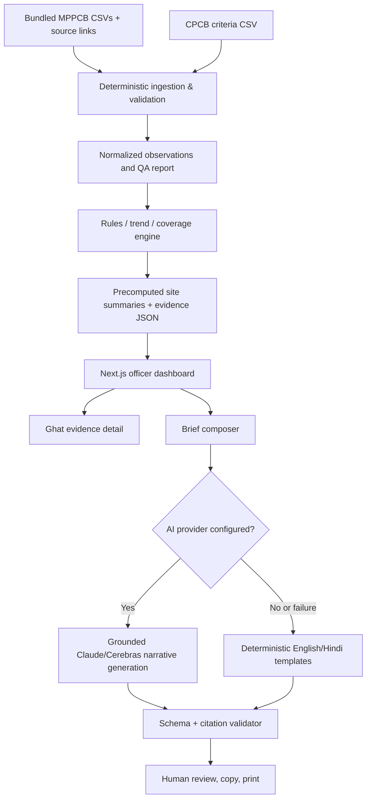

# GhatWatch - Platform Blueprint & Hackathon Implementation Roadmap

**Project stage:** Proposal for team approval, not yet the final GitHub Copilot implementation prompt  
**Challenge:** Track 2, Visarjan Ghat Watch  
**Event:** Claude Impact Lab x Cerebras, Bhopal, 11 October 2026  
**Primary user:** Bhopal Municipal Corporation (BMC) officer planning Durga visarjan  
**Challenge deliverable:** Explainable historical ghat prioritisation with source-backed evidence and a concise officer brief in English and Hindi  
**Reference repository:** https://github.com/Vishal4742/bhopal-impact-lab-2026-problem-statements

> **Decision principle:** GhatWatch is an evidence-to-action planning aid, NOT a live water-quality monitor, regulatory certification tool, proof of immersion-caused pollution, or declaration that any site is legally approved for immersion.

---

## 1. The product in one sentence

Turn 2023-2025 MPPCB water-quality observations into a transparent priority list of Bhopal immersion sites, explain every finding with its CPCB benchmark and source page, surface evidence gaps, and generate a bilingual officer action brief before Durga visarjan on 20 October 2026.

### The 60-second user outcome

1. Open the officer dashboard.
2. Identify the top historical concern and sampling priorities among seven ghats.
3. Select a ghat to inspect DO, BOD, pH, temporal trends, and untested phases.
4. Verify a flagged result through the original MPPCB report and PDF page.
5. Select proposed actions (test, inspect, clean, investigate; refer technical measures to responsible staff).
6. Generate and copy/print a concise English + Hindi brief with source references and uncertainty notes.

**North-star test:** A first-time officer can reach and share an evidence-backed action brief in less than two minutes without assistance.

## 2. What the repository requires, exactly

### Data assets

| Path under `track-2-visarjan-ghat-watch/` | What it contains | Proposed use |
| --- | --- | --- |
| `PROBLEM-STATEMENT.md` | Participant guide, constraints, judging, submission checklist | Requirements/source of truth for product scope |
| `data/DATA_DICTIONARY.md` | Field definitions, site list, missing-value semantics, provenance caveats | Parser and QA specification |
| `data/bhopal_ghats_2023_2025.csv` | 1,524 records; 7 Bhopal ghats; 2023-2025; Ganesh/Durga | Primary dataset; build rankings from this |
| `data/sample_bhopal_2025.csv` | 453 records from 2025 | Fast ingestion smoke tests, not additive to primary dataset |
| `data/mp_immersion_sites_2023_2025.csv` | 21,600 statewide records | Background/stretch only; exclude from initial Bhopal ranking |
| `data/cpcb_water_quality_criteria.csv` | 19 standards rows, classes A-E | Source for explicit rule comparisons |
| `resources/` | Six MPPCB PDFs: 2023, 2024, 2025 immersion reports and three lake-quality references | Evidence documents, not input to an autonomous unverified parser |

### The seven standardised Bhopal site labels

1. Bairagarh (Sant Hirdaram) kund - Upper Lake - high identity confidence; no Durga 2025 table.
2. Khatlapura ghat - Lower Lake - high identity confidence.
3. Prempura ghat - Upper Lake - high identity confidence.
4. Rani Kamlapati ghat / Kamla Park kund - Lower Lake - **medium identity confidence**; the data may conflate two places. Do not show as a confirmed single geolocation.
5. Hathaikheda dam / kund - Hathaikheda dam - high identity confidence.
6. Malikhedi kund - Kund - high identity confidence; no Durga 2025 table.
7. Shahpura lake ghat - Shahpura Lake - high identity confidence.

### Parameters in the supplied tables

`pH`, `Dissolved oxygen`, `BOD`, `COD`, `Total solids`, `Dissolved solids`, `Suspended solids`, `Turbidity`, `Conductivity`, `Chromium`, `Lead`, `Zinc`, `Copper`.

Use CPCB Class B as a **declared comparative screening standard**, not as a complete site certification or proof that Class B is the legally designated class for each ghat:

- Dissolved oxygen (DO): >= 5 mg/L.
- BOD (5 day, 20 C): <= 3 mg/L.
- pH: between 6.5 and 8.5, inclusive.
- Total coliform: <= 500 MPN/100 mL, but **not present in this dataset**; consequently do not certify full Class B compliance.
- Do not invent Class B limits for COD, metals, total solids, turbidity, conductivity, etc.; these remain contextual indicators.

**Units are inferred by dataset authors**, not printed in source reports; label them `assumed units` in an info tooltip/methodology panel.

### Missing and censored measurements

- Empty numeric value and `not sampled`: missing, never zero and never safe.
- `*`, `**`, `_`, `-`: missing/not sampled according to source interpretation.
- `BDL`: below detection limit; left-censored, NOT zero, NOT missing. If no numeric limit of detection is supplied, do not calculate threshold pass/fail from it.
- `ND`: not detected; not a numeric zero. Preserve distinct status.
- Preserve `value_as_printed`, `parameter_as_printed`, and `site_as_printed` for audit display.
- Preserve `source_page` and source report mapping by year; verify PDF zero-based index versus displayed report page.
- Statewide records carrying `needs_check` must not be silently treated as verified Bhopal sites.
- Never merge `sample_bhopal_2025.csv` with the primary file: it duplicates its 2025 rows.

### Organiser constraints

- One workflow, one government officer, one clear outcome.
- Only public information; do not access live government systems or portals for app integration.
- No personal data or secrets.
- Libraries/frameworks allowed; submitted code must have been written after 10:15 AM, 11 October 2026.
- Code must be public on GitHub by **5:00 PM, 11 October 2026**.
- README must identify track, team, members, user, <= 5 run steps, known limitations, and additional data sources.
- Include `LICENSE` (MIT unless organisers specify otherwise), `.env.example`, and no API tokens.
- Screen recording <= 2 minutes is optional but strongly advised.
- Jury evaluates day-one impact at double weight; product, idea, and demo also count. Traceability and honest missing-data handling are explicitly assessed.

## 3. Scope and positioning

### MVP (must be finished and working)

**A. Officer Overview**
- Show 7 Bhopal ghats, data span, latest available year, and clear `historical data - not live` indicator.
- Rank by *historical concern* using reproducible rules; show a **separate** *sampling priority* and *evidence confidence/coverage* so lack of samples does not equal good water quality.
- Show reason tags such as `low DO`, `high BOD`, `repeated finding`, `pre/during/after missing`, `identity needs confirmation`.
- Filters: year, festival (Ganesh/Durga), parameter, phase. Keep global ranking context visible.

**B. Ghat Evidence Detail**
- Show clean site title, source-reported name(s), water body, identity confidence, 2026 operational status = `unverified` by default.
- Parameter table with numeric reading, unit assumption, benchmark, exceedance state, year, festival, phase, printed value and PDF reference.
- DO/BOD/pH before-during-after trends where observations exist; show gaps and not-sampled labels instead of connected lines across holes.
- Historical year comparison and no causal interpretation.
- Open linked source report at page, or show PDF name and page where deep linking is unsupported.

**C. Action Brief Generator**
- Auto-fill context from selected ghats and evidence records, with a human-review checkbox.
- Produce 150-250 word maximum officer brief per language or a concise one-page combined brief.
- Include `Observed evidence`, `What is unknown`, `Recommended immediate verification/inspection`, `Source references`, `Date/year caveat`.
- English + Hindi; copy text and browser print/save-as-PDF, fully functional without backend PDF infrastructure.
- Label suggested cleaning, aeration, or treatment as `subject to local technical assessment`; never give autonomous site closure/approval decisions.

**D. Transparent Methodology**
- Show Class B assumption, threshold table, ranking method, missing-data policies, and limits of evidence.
- Give users a download of the *computed* ranking/evidence JSON (optional if effortless).

### Optional, only if MVP is ready

- AI Q&A: `Why is Bairagarh flagged?`, `Which ghats have insufficient 2025 Durga data?`
- Verified-only map; never make up coordinates for ambiguous sites.
- Bilingual switch for all UI chrome.
- Side-by-side evidence comparison of two ghats.
- Statewide benchmark context after cleaning and validation.
- Public PDF link opener with robust deep-link fallback.

### Intentionally out of scope for hackathon

- Live sensor streams, forecasts, ML predictive training, claims about present pollution, human health conclusions.
- Auto-recommending an authorised immersion site in 2026 without official status verification.
- End-to-end GIS/geocoding for all sites without validated coordinates.
- Writing to a government portal; authentication, citizen accounts, admin panels.
- OCR of all historical reports; generic RAG/vector database; a complex backend/deployment footprint.

## 4. Core user experience and wireframes

### Screen 1: Officer priority dashboard

```text
+-------------------------------------------------------------------------------------+
| GHATWATCH           Historical evidence: 2023-2025          EN / HI    Methodology |
| Officer planning workspace  |  Durga Visarjan: 20 Oct 2026  | Not a live feed     |
+-------------------------------------------------------------------------------------+
| 7 ghats tracked | 1,524 source rows | Last supplied year: 2025 | Evidence gaps: ... |
+-------------------------------------------------------------------------------------+
| Filter [2023-2025] [Ganesh/Durga] [DO/BOD/pH] [Pre/During/After]                 |
+-------------------------------------------------------------------------------------+
| HISTORICAL CONCERN      EVIDENCE CONFIDENCE     2026 SITE STATUS                  |
| 1 [site name] [reason tags] [sample coverage]  [Unverified] [Inspect >]         |
| 2 [site name] [reason tags] [sample coverage]  [Unverified] [Inspect >]         |
| ...                                                                                 |
+-------------------------------------------------------------------------------------+
| Sampling-priority list: concerning records OR insufficient / unreliable evidence  |
| [Build Officer Brief] [See Methodology]                                            |
+-------------------------------------------------------------------------------------+
```

**Avoid false precision:** Never display an official-sounding `water safety score 91/100`. Use `Historical concern: elevated`, `Evidence confidence: limited`, plus an optional clearly disclosed methodology-derived ordering score.

### Screen 2: Ghat evidence panel

```text
+-------------------------------------------------------------------------------------+
| GHAT DETAIL: [Standard name]                     [Historical concern: elevated]    |
| Reported labels [original names] | Match confidence [high/medium]                |
| 2026 immersion authorisation: UNVERIFIED (do not interpret as permitted)           |
+-------------------------------------------------------------------------------------+
| Evidence summary | DO  | BOD  | pH  | Other measurements                         |
| Before ----- during ----- after     (missing phases visibly marked)               |
| 2023 2024 2025 trends, with Ganesh/Durga selected separately                        |
+-------------------------------------------------------------------------------------+
| OBSERVATION         OBSERVED     CLASS B SCREENING    STATUS     SOURCE              |
| DO 2025 Ganesh ...  [value]      >=5 mg/L             below      MPPCB 2025 p.xx    |
| BOD ...             [value]      <=3 mg/L             above      MPPCB 2025 p.xx    |
| Lead ...            [value]      no Class B criterion contextual MPPCB 2025 p.xx   |
| DO ...              not sampled  >=5 mg/L             unknown    MPPCB 2025 p.xx    |
+-------------------------------------------------------------------------------------+
| Data limitations | Original printed values | Source PDF | Select for brief        |
+-------------------------------------------------------------------------------------+
```

### Screen 3: Officer action brief

```text
+-------------------------------------------------------------------------------------+
| OFFICER BRIEF  |  ENGLISH  /  HINDI  | generated from historical evidence          |
| Scope: selected site(s), report years, rationale                                  |
| Evidence: precise figures and PDF pages, displayed as footnotes                   |
| Unknowns: new samples needed; identity unresolved; 2026 status unverified          |
| Proposed checks: sample, inspect, investigate, escalate technical interventions    |
|                                                                             [Edit]  |
| [Copy English] [Copy Hindi] [Print / Save PDF] [Open evidence]                      |
+-------------------------------------------------------------------------------------+
```

### Golden-path demo

Select Bairagarh -> show reported zero DO in the historical sample with source reference -> acknowledge missing pre/post observations and missing Durga 2025 table -> generate a targeted fresh-sampling recommendation -> display Hindi/English brief -> copy or print.

**Important:** The source pack says four DO=0 readings at Bairagarh across 2023 and 2025. Verify individual observations against the local CSV and relevant PDF pages before choosing a value for the recorded demo.

## 5. Architecture



**Default technology:** Next.js App Router + TypeScript + Tailwind + shadcn/ui + Recharts; Python/pandas for one-time ETL if helpful; precomputed JSON bundled with Next.js. No Postgres necessary for the MVP. Optional server-only AI route handlers.

### Proposed implementation repository structure

```text
ghatwatch/
  README.md
  LICENSE
  .gitignore
  .env.example
  package.json
  public/
    data/
      ghats.json
      observations.json
      ranking.json
      qa-report.json
    sources/                  # optional locally bundled public PDFs if practical
  source-data/
    bhopal_ghats_2023_2025.csv
    sample_bhopal_2025.csv
    cpcb_water_quality_criteria.csv
    DATA_DICTIONARY.md
  scripts/
    build-dataset.py          # or TypeScript equivalent
  src/
    app/
      page.tsx                # dashboard
      ghats/[id]/page.tsx     # ghat detail
      methodology/page.tsx
      api/brief/route.ts      # server-only, optional AI
      api/ask/route.ts        # stretch goal
    components/
      SiteRankingTable.tsx
      GhatEvidencePanel.tsx
      PhaseTrendChart.tsx
      EvidenceReference.tsx
      BriefComposer.tsx
      MissingDataBadge.tsx
    lib/
      data.ts
      standards.ts
      analysis.ts
      ranking.ts
      evidence.ts
      brief-template.ts
      ai-provider.ts
      schemas.ts
    types/
      water-quality.ts
  tests/
    parsing.test.ts
    standards.test.ts
    ranking.test.ts
    missing-values.test.ts
    citations.test.ts
    brief.test.ts
  docs/
    PLATFORM_BLUEPRINT.md
    METHODOLOGY.md
    DATA_AUDIT.md
    DEMO_SCRIPT.md
```

If building all this under deadline is unrealistic, merge components/files: functionality matters more than perfect folder taxonomy.

### Minimal derived-data models

```ts
// Illustrative contracts, not yet an instruction to implement.
type MeasurementStatus = 'numeric' | 'not_sampled' | 'below_detection' | 'not_detected' | 'unparsed';
type BenchmarkStatus = 'within' | 'outside' | 'unknown' | 'no_applicable_class_b_limit';

type Observation = {
  id: string;
  siteId: string;
  siteAsPrinted: string;
  siteMatchConfidence: 'high' | 'medium' | 'low' | 'unknown';
  year: number;
  festival: 'Ganesh' | 'Durga';
  phase: 'pre' | 'during' | 'after';
  parameter: string;
  numericValue: number | null;
  valueAsPrinted: string;
  measurementStatus: MeasurementStatus;
  unit: string | null;
  unitIsAssumed: boolean;
  sourcePdf: string;
  sourcePage: number | null;
  benchmarkStatus: BenchmarkStatus;
};

type SiteSummary = {
  siteId: string;
  historicalConcern: 'elevated' | 'moderate' | 'lower_observed' | 'insufficient_evidence';
  samplingPriority: 'priority_retest' | 'routine_verify' | 'needs_site_validation';
  concernScore: number | null; // proposal, explicitly nonofficial
  evidenceCoverage: number;    // 0..1, denominator definition documented
  identityConfidence: string;
  topReasons: string[];
  evidenceIds: string[];
  currentOperationalStatus: 'unverified';
};
```

## 6. Data preparation and audit rules

### Step-by-step ingestion

1. Load the original Bhopal CSV, preserve raw strings, validate expected column names and row count (1,524 according to repository).
2. Load the CPCB benchmark CSV and derive applicable Class B thresholds; confirm limit direction and units.
3. Map seven standardised site labels to stable IDs; preserve aliases, original labels, identity confidence and water body.
4. Parse numeric values only where parseable; classify BDL, ND and missing distinctly. Reject any accidental `0` replacement.
5. Build deterministic source keys by report year and festival. Preserve page numbers and prepare PDF file URLs or local links.
6. Audit for exact duplicates, conflicting duplicate keys, unrecognised parameters, unexpected years, invalid phases and extreme values; **flag**, never silently delete.
7. Compare small samples against original report pages manually: all three years, both festivals, and known problematic sites. Log checked rows and findings in `DATA_AUDIT.md`.
8. Compute coverage from expected site x year x festival x phase x relevant parameter combinations, distinguishing `absent in CSV` vs `explicit not sampled` where possible.
9. Generate normalized JSON and QA summary; assert each chart, table and ranking reason points to evidence IDs.
10. Record the exact source URLs, acquisition date, methodology version, and data timestamps.

**Data audit caveat:** The parent guide says the Bhopal file was spot-checked across six tables, not fully verified. The statewide file has 879 `needs_check` rows and some cross-page duplicates. Avoid using statewide data in rankings unless additional QA is performed.

## 7. Explainable historical concern & sampling priority

### A deliberately transparent scoring proposal

**This formula is a proposed product heuristic, not an MPPCB/CPCB risk index.** Adjust only after examining the real distribution and consulting the team/domain mentor. Put the formula and test cases in `METHODOLOGY.md`.

For numeric DO:

```
do_severity = clamp((5 - measured_DO) / 5, 0, 1)
```

For numeric BOD:

```
bod_severity = clamp((measured_BOD - 3) / 3, 0, 1)
```

For numeric pH (distance outside the allowed interval):

```
ph_severity = clamp(max(6.5 - pH, pH - 8.5, 0) / 2, 0, 1)
```

A measured value within limits has severity 0. `BDL`, `ND`, and missing have **no numeric severity** unless further detection-limit evidence makes a defensible comparison possible.

Provisional site index (among sites with adequate numeric records):

```
concernIndex = 100 * (
    0.45 * weightedMeanSeverityOfObservedDO_BOD_pH
  + 0.35 * fractionOfObservedDO_BOD_pHOutsideBenchmark
  + 0.20 * shareOfSampledFestivalYearsWithAtLeastOneExceedance
)
```

- Use explicitly documented year weights, e.g. 2023=1, 2024=1.25, 2025=1.5, if recency weighting is retained. Compare a no-recency sensitivity variant. Do not pretend these weights are official.
- Treat a single festival-year as one observation window for recurrence so larger tables do not dominate.
- DO/BOD/pH are the only parameters entering this Class B-based index. Metals and COD remain review signals, not fabricated legal exceedances.
- Derive a distinct **sampling priority** from confirmed historical findings, insufficient recent coverage, and uncertain site identity.
- Show components and denominator counts in the detail view. Preserve source IDs for every contributing observation.
- If a site lacks enough numeric evidence, show `Insufficient evidence`, not a low index or a green-safe indicator.
- Never infer that immersion caused changes merely because before/during/after values differ.

### Evidence confidence (separate from concern)

Expose four visible factors instead of collapsing everything into an opaque confidence claim:

- Numeric observation coverage (vs expected analytical windows).
- Recency of available records.
- Site name match confidence.
- Provenance QA: checked against original PDF or unverified extracted record.

An officer can therefore see `historical concern: elevated; evidence: incomplete; action: retest`.

### Eligibility and operation caveat

A February 2026 news report refers to NGT-driven lake immersion restrictions and BMC alternative facilities. **Do not assert which historical or new locations are currently legally authorised** without a verified official 2026 source. Display status `not verified` and explain that site selection/permissions require BMC confirmation. Never mark a historical site `open for immersion` based on water tests.

## 8. AI layer and provider needs

### Recommended AI deployment

**Primary:** Claude API for language generation and context-aware explanations.  
**Alternative or secondary:** Cerebras inference API if credentials/model access are provided.  
**Zero-dependency fallback:** deterministic bilingual templates generated from validated structured evidence.

The user will supply API access if required. **Do not block development on API keys**. Support environment variables, a provider adapter, retry/timeout and graceful fallback.

#### Example environment variables

```dotenv
AI_PROVIDER=anthropic
ANTHROPIC_API_KEY=
CEREBRAS_API_KEY=
AI_MODEL=
```

Exact model identifiers must be set from the actually available account/provider; do not hard-code invented provider/model names.

### Inputs to the LLM

Send selected source-backed facts only, not free-form speculative PDFs or arbitrary long raw data. Each fact has an evidence ID, numeric value/status, date window, report URL/page, applicable benchmark and limitation flags. Ask for structured JSON with `englishBrief`, `hindiBrief`, `actions`, `evidenceIdsUsed`.

### Hard AI guardrails

- Never calculate/recalculate authority thresholds inside the model.
- Never fabricate data, dates, PDF pages, site status, legal bans, remediation cost or health outcomes.
- For missing/BDL/ND: explicitly describe uncertainty; no invented numerical estimates.
- All numeric claims in the generated result must match supplied facts; validate against allowed evidence IDs, or use deterministic brief templates.
- Label proposed actions as *recommendations for officer/technical review*, not completed operations.
- Do not reveal API credentials in client bundles, logs or source control.

### AI-assisted Q&A (stretch)

Examples:

- `Why is this ghat prioritised historically?`
- `Which locations lack 2025 Durga testing?`
- `Which concerns persist across multiple sampled years?`
- `Give me a 90-second Hindi officer briefing.`

Evidence retrieval should be straightforward structured filtering over observations and site summaries; a vector database is not necessary.

## 9. Pages and testable actions

| Route or panel | Officer action | Real output |
| --- | --- | --- |
| `/` | Filter/sort priorities | Dynamic rankings computed from selected dataset scope |
| `/ghats/[id]` | Inspect evidence | Parameter table, trend plot, coverage, source links |
| Evidence drawer | Open source | Report name, PDF page, original printed value |
| `/methodology` | Audit criteria | CPCB table, formulas, dataset issues, limitations |
| Brief composer | Select site(s), generate | English + Hindi evidence-linked short brief |
| Copy / print | Share | Clipboard and print-friendly one-page document |

All controls must function. No purely decorative search boxes, inert filters or fake download buttons.

## 10. Acceptance tests (minimum)

1. All seven listed ghats appear; records trace to source-file rows.
2. The 2025 sample is never counted twice.
3. Numeric `DO = 0` is preserved as an observed zero; missing numeric value is null, not zero.
4. `BDL` and `ND` are displayed distinctly, without fabricated concentrations.
5. DO=4.9 mg/L is below Class B threshold; DO=5.0 is at threshold.
6. BOD=3.1 mg/L is above Class B threshold; BOD=3.0 is at threshold.
7. pH=6.49 and pH=8.51 are outside; 6.5 and 8.5 are within.
8. COD and metals show `no Class B limit in supplied benchmark` rather than pass/fail.
9. Missing before/after values remain gaps on charts; no interpolation or false causal conclusion.
10. Rani Kamlapati/Kamla Park identity ambiguity is surfaced on ranking/detail/brief.
11. A ghat with no numeric tests cannot receive a green `safe` classification.
12. Every ranking driver links to at least one observation ID and year+PDF+page.
13. Source PDF link has graceful fallback if page anchors are unavailable.
14. Hindi and English briefing each include supported numbers and uncertainty.
15. AI provider failure leaves deterministic analysis and template briefing usable.
16. No 2026 site is labelled authorised without an authoritative evidence record.
17. Responsive layout works at desktop and a typical phone width.
18. `.env`/API keys never enter version control, logs or browser code.
19. `npm run build` and available tests pass in a clean checkout.
20. README setup takes five steps or fewer.

## 11. Suggested team split (4-5 people)

- **Data / rules owner:** ETL, QA report, scoring, thresholds, test evidence.
- **Frontend owner:** responsive dashboard, filters, navigation and details.
- **Charts / UX owner:** trend charts, evidence panel, print-ready briefing (can merge with frontend for a 4-person team).
- **AI / integration owner:** provider adapter, brief generation and fallback.
- **Research / presentation owner:** PDF spot checks, site status research without live-system integrations, Hindi review, README, 2-minute recording, pitch.

Agree on shared JSON/TypeScript contracts in the first 15 minutes to avoid blocking frontend work.

## 12. Roadmap with timeboxes, ordered by dependency

**The official hard cutoff is 17:00 IST, 11 October 2026. Plan to submit substantially earlier.**

| Sprint | Budget | Work | Exit condition |
| --- | --- | --- | --- |
| 0. Contract & ownership | 15 min | Fork/create project; read guide; agree schema, ranking semantics, one demo scenario; split roles | Team can state 60-second user outcome |
| 1. Data baseline | 35 min | Import CSV + CPCB limits; normalise missing/censored values; QA, select 7 site IDs | Deterministic JSON + summary counts available |
| 2. Core rules & tests | 40 min | Rule checks, coverage, historical concern, sampling priority, provenance links | Unit tests pass; at least one ranking explanation correct |
| 3. Working UI | 60 min | Dashboard, filters, detail, chart, missing-data display | Full dashboard/detail flow works locally |
| 4. Brief workflow | 35 min | Evidence-backed English/Hindi templates, optional AI route, copy/print | One-click reproducible bilingual brief |
| 5. Validation & polish | 35 min | Check suspicious PDF pages and labels, handle failure cases, responsive improvements | No unsupported claims / broken controls |
| 6. Package and submit | 20 min | README, sources, MIT license, `.env.example`, fresh-start run, push, 2-min capture | Public link submitted with buffer before 17:00 |

**Total timebox: ~4 hours.** If the remaining time is shorter, first cut AI chat, map, statewide comparisons, and visual flourishes; **never cut source traceability, missing-data honesty, or the officer brief.**

### Milestone gates

- **Gate A (after Sprint 2):** Validated data and reproducible evidence-linked rules.
- **Gate B (after Sprint 4):** Full officer decision workflow works without a model key.
- **Gate C (before submission):** Verified numbers, no broken exports, tested setup and public repo.

### Demo / pitch sequence (<= 2-minute recording)

- **0:00-0:15:** Officer needs to make pre-visarjan decisions; evidence is buried in PDFs.
- **0:15-0:35:** Show transparent historical priority ranking and coverage gaps.
- **0:35-1:05:** Open a site; show actual DO/BOD and original PDF citation; explain missing observations.
- **1:05-1:35:** Generate short bilingual action brief with a fresh-sampling recommendation.
- **1:35-2:00:** Print/copy, show methodology and limitation: historical data, not a current site approval.

## 13. Definition of done and tradeoffs

### Must be true before calling this ready

- The ranked view changes meaningfully with dataset filters.
- The user can tell `historical concern`, `sampling priority`, and `evidence completeness` apart.
- A cited value opens or identifies the proper source report and page.
- No `not sampled` or `BDL` observation is quietly converted to zero.
- The bilingual output is a real officer brief, short enough to forward.
- App boots and works offline from the public packaged dataset except optional AI calls.
- No secret appears in the public repo.
- README explains the methodology, caveats, legal/operational unknowns and run steps.

### If time runs out, preserve in this order

1. Accurate data ingestion and explicit missing-value semantics.
2. Reproducible ranking with evidence IDs.
3. Usable officer dashboard and site detail.
4. Bilingual brief generation with deterministic fallback.
5. README, working build, submitted public URL and recording.
6. Optional AI chat, map, animation and statewide benchmarking.

## 14. Risks and open decisions for team validation

| Question | Proposed choice | Reason |
| --- | --- | --- |
| Official product name | GhatWatch | Instantly understandable |
| Primary AI | Claude, with optional Cerebras adapter | Event fit; API can be supplied later |
| Runtime architecture | Next.js only; precompute with Python | Low setup/deployment risk |
| Standards | CPCB Class B as a screening comparator | Explicit and documented, not full compliance |
| Ranking | Historical concern + independent sampling priority | Avoid treating gaps as safety |
| Score weighting | Heuristic, disclosed and testable | Not claimed official |
| Site status for 2026 | Unverified until official evidence | Avoid prohibited-site recommendations |
| Map | Stretch, verified points only | Site identity conflict makes invented coordinates risky |
| Export | Clipboard + print to PDF | Works without document infrastructure |
| Data sources | Bhopal primary; statewide reference only | Statewide quality concerns |
| Model outage | Template fallback | Demo remains functional |

## 15. Source links and verification notes

**Primary repository:** https://github.com/Vishal4742/bhopal-impact-lab-2026-problem-statements

**Problem guide:** https://github.com/Vishal4742/bhopal-impact-lab-2026-problem-statements/blob/main/track-2-visarjan-ghat-watch/PROBLEM-STATEMENT.md

**Data dictionary:** https://github.com/Vishal4742/bhopal-impact-lab-2026-problem-statements/blob/main/track-2-visarjan-ghat-watch/data/DATA_DICTIONARY.md

**CPCB official criteria:** https://cpcb.gov.in/water-quality-criteria/

**2025 MPPCB immersion report:** https://www.mppcb.mp.gov.in/proc/mon/Ganesh_and_Durga_visarjan_report-2025.pdf

**2024 MPPCB immersion report:** https://www.mppcb.mp.gov.in/proc/mon/Ganesh_and_Durga_visarjan_report-2024.pdf

**2023 MPPCB immersion report:** https://www.mppcb.mp.gov.in/proc/mon/Idol_immer._Report_23_CPCB.pdf

**2026 secondary reporting (operational status is NOT independently certified):** https://www.freepressjournal.in/amp/bhopal/mp-news-idol-immersion-to-shift-from-lakes-to-safer-sites-ngt-ban-pushes-bmc-to-build-4-dedicated-ghats

**Access limitation during planning:** The public README, participant guide, data dictionary and published CSV metadata were accessible through rendered GitHub pages, but the planning environment could not clone the repository or independently run all 1,524 CSV records or open every original PDF. Therefore any specific final numerical ranking, source-page alignment, and row-level site/festival combination MUST be verified by the implementation agent against the locally cloned original files; do not treat this blueprint as proof of a completed data audit.

---

## 16. Next action after approval

Generate the **full GitHub Copilot build brief**, designed to be pasted into Copilot Agent mode in the actual project repo. It will include exact input-file inspection commands, a phase-by-phase implementation order, naming/contract rules, full acceptance test specifications, source citation requirements, UI acceptance criteria, AI prompting/validation/fallback policies, and the final submission checklist. Copilot should inspect actual local files before writing assumptions into code.

**Approval requested on:** the one-workflow scope, ranking split, architecture, AI integration, optional map, and visual design level. Do not proceed to the lengthy coding prompt until the team agrees.
