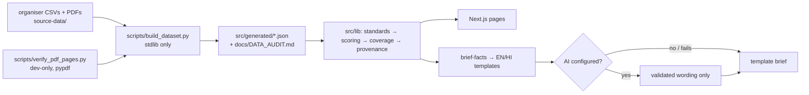

# GhatWatch

**Track 2: Visarjan Ghat Watch** · Claude Impact Lab × Cerebras, Bhopal · 11 October 2026

**For one user:** the Bhopal Municipal Corporation officer planning Durga visarjan (20 Oct 2026).
**One workflow:** see which ghats to re-test first → open the exact source readings → send a short English + Hindi brief.

GhatWatch lines up three years of MPPCB immersion monitoring (2023–2025, 7 Bhopal ghats, 1,524 readings) against CPCB Class B screening levels, ranks the ghats with a transparent formula, shows every gap as a gap, and links each number to its CSV row and report page.

## Team

The compressed [NeerSetu demo recording](docs/media/README.md) is available in four playable clips, each below 23 MB.

| Name | Role |
|---|---|
| [MEMBER NAME] | [ROLE] |
| [MEMBER NAME] | [ROLE] |
| [MEMBER NAME] | [ROLE] |
| [MEMBER NAME] | [ROLE] |

Team name: **[TEAM NAME]**

## Run it (4 steps)

Requires Node 20+ and npm. Python 3 is only needed to regenerate data (the generated JSON is committed).

```bash
npm install
npm test            # 58 tests: data, standards, scoring, provenance, brief, AI fallback, plan/calendar, map anchors, UI
npm run build && npm start   # or: npm run dev
# open http://localhost:3000
```

Optional: `npm run data:build` regenerates `src/generated/*.json` and `docs/DATA_AUDIT.md` from `source-data/` (Python 3 standard library only).

### Optional AI wording (not needed for anything)

Copy `.env.example` to `.env.local` and set, for example:

```dotenv
AI_PROVIDER=anthropic        # or cerebras / openai_compatible
AI_MODEL=<model id from your account>
ANTHROPIC_API_KEY=...        # or CEREBRAS_API_KEY=...
```

Keys stay on the server. The model may only rewrite purpose and action wording, including the short ranking summary; scoring, numbers and citations remain deterministic. Output is rejected if it adds unsupported numbers, unknown IDs, or safety/causal/legal/health claims. The ranking summary has been verified with live Cerebras calls using `qwen-3.8-27b`. If local Node HTTPS calls fail on certificate trust, use a recent Node version with `NODE_OPTIONS=--use-system-ca`; do not disable TLS verification.

## What works

- **Plan (`/`)** — opens on India (React Three Fiber, Natural Earth India-POV outline) with today's IST date and the countdown to the next configured visarjan. **Test the waters** flies the camera into Bhopal's lakes (OpenStreetMap polygons). Left: interactive 3D map — one column per ghat, height = concern index, colour = band, pulse = urgent re-test; every marker states how it was placed (OSM-named feature / locality / lake only / name match only). Right: the highest-risk ghats this festival (all seven assumed in use; comparative reasons with page citations), then the dated plan (pre-immersion baseline → request missing tables → inspect → during → one-week-after), ranked ghats on the **upcoming festival's past seasons**, and per-ghat findings with report-page links. `?asOf=YYYY-MM-DD` rehearses another date; `?view=map&site=<id>` deep-links. 2D SVG fallback without WebGL.
- **Ranking (`/ranking`)** — a short English/Hindi summary of the leading ghats, followed by plain-language reasons and next steps. AI rewrites only the short explanation; next steps remain source-based. AI wording is requested once per scope when configured; source-based wording stays visible if it fails. Source readings, coverage and methodology are expandable; year / festival / phase filters remain in the URL. Pick up to 3 ghats for a brief.
- **Ghat detail (`/ghats/[id]`)** — printed names by festival, identity caveat, score breakdown with the formula filled in, all reasons with citations, phase coverage grid, DO/BOD/pH charts with one line per festival-year and gaps left as gaps, and a filterable table of every source row with citation (CSV line, printed value, report, verified PDF page, copy button).
- **Officer brief (`/brief`)** — deterministic English + Hindi drafts: purpose, cited evidence, unknowns, proposed actions for review, sources. Copy English / Hindi / both, Print / Save PDF (print stylesheet), unticked "Reviewed by officer" box. Works with no API key.
- **Methodology (`/methodology`)** — criteria table, formulas, missing-data rules, coverage, priority, page verification, limits.
- **Bundled source PDFs** served at `/reports/2023|2024|2025` with `#page=N` deep links (every row's page was text-verified).

## What it does not do / limitations

- **Historical only (2023–2025). Not live.** Says nothing about current water quality.
- **Class B is a screening comparison**, not an official designation. Only DO, BOD and pH are compared. **Total coliform was not measured**, so no site can be called Class B compliant.
- **Units are assumed** — the reports print none.
- **Not causal.** Many exceedances were already present before immersion.
- **No 2026 site status.** Authorisation is "unverified" everywhere; the NGT ban news is context only.
- **Rani Kamlapati ghat / Kamla Park kund** may be two places (medium identity confidence) — the map shows both candidates joined by a dashed line.
- **Map positions are approximate.** The MPPCB data has no coordinates; markers come from OpenStreetMap features found by name or the lake printed in the CSV (Malikhedi and the Kamla Park candidate are name matches only). Confirm the physical point before dispatch.
- The plan only knows visarjan dates listed in `src/lib/calendar.ts` (currently Durga 2026, from the organiser guide). After 27 Oct 2026 it says no date is configured until one is added.
- Bairagarh and Malikhedi have **no 2025 Durga table** in the reports — shown as missing, never as clean.
- The concern index and the urgent/priority triggers are **disclosed heuristics**, not CPCB/MPPCB policy.
- The statewide file (21,600 rows) is profiled but **not used**.
- Hindi brief text is a team translation — **needs native-speaker review**.
- AI adapters are unit-tested with mocks; ranking-summary wording has also been verified with a live Cerebras account. Anthropic live verification remains outstanding.
- No accounts, no database, no live government connection.

## How it works



Details: [docs/ARCHITECTURE.md](docs/ARCHITECTURE.md) · scoring: [docs/METHODOLOGY.md](docs/METHODOLOGY.md) · data checks: [docs/DATA_AUDIT.md](docs/DATA_AUDIT.md) · tests: [docs/TEST_REPORT.md](docs/TEST_REPORT.md) · demo: [docs/DEMO_SCRIPT.md](docs/DEMO_SCRIPT.md)

## Data and sources

All data comes from the organiser pack, copied unmodified into `source-data/organiser-track-2/`:
https://github.com/Vishal4742/bhopal-impact-lab-2026-problem-statements (commit `6b96823`, folder `track-2-visarjan-ghat-watch`), prepared from:

- MPPCB Idol Immersion Report 2023 — https://www.mppcb.mp.gov.in/proc/mon/Idol_immer._Report_23_CPCB.pdf
- MPPCB Ganesh and Durga Visarjan Report 2024 — https://www.mppcb.mp.gov.in/proc/mon/Ganesh_and_Durga_visarjan_report-2024.pdf
- MPPCB Ganesh and Durga Visarjan Report 2025 — https://www.mppcb.mp.gov.in/proc/mon/Ganesh_and_Durga_visarjan_report-2025.pdf
- CPCB water quality criteria — https://cpcb.gov.in/water-quality-criteria/

Files used: `data/bhopal_ghats_2023_2025.csv`, `data/sample_bhopal_2025.csv` (subset check only), `data/cpcb_water_quality_criteria.csv`, `data/mp_immersion_sites_2023_2025.csv` (audit only), `resources/*.pdf`.

**Extra public data (map only, saved in `source-data/geo/`):**

- OpenStreetMap © contributors, ODbL — lake polygons (Upper Lake relation 5414768, Lower Lake way 28672430, Shahpura Lake way 28672561, Hataikheda Dam way 28826931) and named features used as anchors, via the Overpass API on 11 Oct 2026. https://www.openstreetmap.org/copyright
- Natural Earth `ne_10m_admin_0_countries_ind` (India point-of-view), public domain — https://github.com/nvkelso/natural-earth-vector. Simplified for display; not an authoritative boundary.
- Durga visarjan 2026 date as given in the organiser guide (Drik Panchang link).

## Licence

Code: MIT ([LICENSE](LICENSE)). Source data and PDFs are public documents from the organiser pack and are not covered by the code licence.
